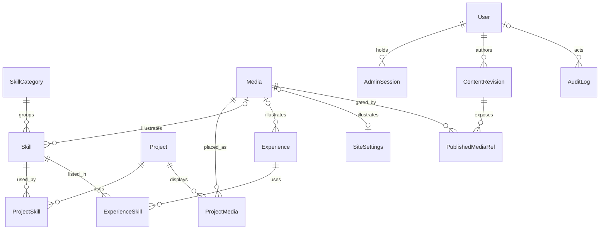

# Proposed database model

Keystone owns the list definitions and generated Prisma schema. PostgreSQL owns foreign keys, uniqueness and check constraints. Apply reviewed migrations to a disposable database and verify the generated schema before deploying. Keep provider identifiers and internal editor fields out of public response types. [Keystone configuration](https://keystonejs.com/docs/config/config/) · [Keystone migration guide](https://keystonejs.com/docs/guides/database-migration/)

## Keystone and PostgreSQL integration

Use Keystone core `8.3.0` and auth `10.0.6` with matching Prisma CLI, client and `@prisma/adapter-pg` `7.10.1`, `pg` 8 and PostgreSQL 18. The verified package ranges allow this combination. Keystone's runtime receives `PrismaPg` through `db.prismaClientOptions`. The Prisma CLI reads its target and paths from `prisma.config.ts`. Verify both configurations against the same disposable target in Phase 2. The shipped Keystone package supports building and starting without its native Admin UI. Its context delegates transactions to the generated Prisma client. [Keystone package](https://registry.npmjs.org/@keystone-6%2fcore/8.3.0) · [Keystone database configuration](https://keystonejs.com/docs/config/config/#postgresql) · [CLI](https://keystonejs.com/docs/guides/cli/) · [Prisma v7 database matrix](https://www.prisma.io/docs/orm/v7/reference/supported-databases)

Generate the Prisma and GraphQL schemas with Keystone. Use reviewed Prisma migrations for shared databases and verify migration history on an empty and a prior-version database. Run `prisma migrate deploy` from the CMS project as a separate release step. Use `keystone dev --no-db-push` for migration-managed databases. Version the generated GraphQL and Prisma schemas for review. Validate their drift in CI with a frozen Keystone build and keep the generated client a build artifact. Add raw SQL only where a required constraint is unsupported by the pinned generator, then prove the database constraint survives regeneration and migration replay. [Keystone migration workflow](https://keystonejs.com/docs/guides/database-migration/)

## Entities and constraints

Use stable Keystone IDs, UTC timestamps for events, normalized unique slugs where specified, and deterministic sorting with ID as a tie-breaker. Editorial text is English at launch. Add translated fields when the translation workflow is agreed.

| Entity | Fields and invariants |
| --- | --- |
| `User` | Unique normalized email, name, Keystone password field, role initially `OWNER`, active flag and timestamps. Deactivate accounts while preserving audit attribution. |
| `AdminSession` | Keystone stored-session backing row with opaque unique key, owner FK, expiry and creation time. Index expiry for cleanup. No public or generated admin API exposure. |
| `Project` | Title, unique reserved slug, summary, role, category, optional start/end dates, description, validated links, ordered typed case-study sections, display order, featured flag, SEO fields, and publication metadata. Blocks can begin with text, heading, image reference and link. Keep optional results absent until verified. |
| `SkillCategory` | Name, unique slug, description and display order, with its own publication metadata. |
| `Skill` | Name, unique slug, category FK, proficiency enum `BEGINNER`, `INTERMEDIATE`, `ADVANCED`, `UNVERIFIED`, description, optional logo media FK, constrained brand color, visibility and display order, plus publication metadata. |
| `Experience` | Company, position, optional logo media FK, required start month, optional end month, employment status `UNKNOWN`, `CURRENT` or `ENDED`, description, responsibilities, achievements, display order and publication metadata. |
| `Media` | Immutable unique storage key per upload, processing state `PENDING`, `READY`, `REJECTED` or `ARCHIVED`, detected MIME, byte size, dimensions, category, optional default alt text, uploader and timestamps. A replacement creates a new ID and changes selected draft relationships. |
| `ProjectSkill` | Required project and skill FKs, unique pair, optional ordering and inverse lookup index by skill. |
| `ExperienceSkill` | Required experience and skill FKs, unique pair and inverse lookup index by skill. |
| `ProjectMedia` | Required project and media FKs, placement role `COVER` or `GALLERY`, display order, optional alt override and caption. Unique project/media/role and at most one cover per project. |
| `SiteSettings` | Fixed singleton key. Public name, headline, introduction, biography, interests, career direction, contact links, optional profile image, approved home section copy, default SEO and publication metadata. Private operational configuration remains in environment settings. |
| `SceneConfig` | Fixed singleton key, bounded display options and five typed station overrides keyed by canonical station ID. Each override has label, description, visible flag, display order and optional category or route target. This aggregate has publication metadata. |
| `ContentRevision` | Immutable aggregate kind, aggregate ID, revision number, schema version, validated snapshot payload, author FK and timestamp. Unique aggregate kind/ID/revision number. Roots reference their current published revision by FK. Service verifies ownership of the revision before changing the pointer. |
| `PublishedMediaRef` | Small projection of media delivery permissions with required media and revision FKs, unique media/revision pair and index by revision. It represents only live snapshots and is maintained in the publication transaction. |
| `AuditLog` | Append-only actor FK, action, subject kind/ID, optional revision references, timestamp, bounded metadata and correlation ID. Index by subject/time and actor/time. |

Project and settings links accept approved schemes. Gallery destinations use a discriminated route union with approved internal slugs or anchors. Skills and experiences can be edited from each relevant admin module while join rows keep one authoritative relationship. Initial categories come from owner-approved taxonomy. Add a category table for projects only if there is a real need for independent category administration.

State and ordering queries use indexes that match the actual public and admin filters. Use generated-schema customizations for supported compounds and indexes. Where Prisma cannot express a required constraint, such as the conditional cover uniqueness or a singleton key CHECK, add it through reviewed SQL and test repeated generate and migration cycles. Never repair schema drift by editing generated files in place.

## Relationships

Each publishable root can point to zero or one current `ContentRevision`. The revision history is identified by aggregate kind and ID. These polymorphic historical references and the restricted scene override references are checked in the service. Active references to related projects, skills and categories are resolved from their current published revisions. An archived or hidden related item disappears from public relationships without exposing its draft. A visible published skill can remain accessible without a category label if its category is archived.

The Project slice uses archive for editorial removal and keeps its revisions and audit history. Hard deletion and revision purging are deferred pending retention and reference rules. Restrict deletion of a skill, category or media item while references require it. Media archival is blocked while a live media reference exists, and physical deletion is deferred while a retained revision may need the file. A restore revalidates every relation and reports unavailable assets or targets. Reserve a published project's slug through archival. Lock the slug after first publish for launch and design redirects before offering renames.

## Drafts, publishing and history

Keep one normalized editable aggregate and append a versioned snapshot on each explicit save. Store a monotonically increasing draft version and a separate publication version, plus `publishedRevisionId`, `firstPublishedAt` and `archivedAt`. The publication version advances only on publish or archive. This prevents delayed requests from reapplying an older state after an intervening publish/archive cycle. Draft edits leave the public pointer unchanged.

| Operation | Required semantics |
| --- | --- |
| Create or save | Create the first draft and its revision in one transaction. Subsequent saves require the expected draft version. Update editable fields and joins, append the revision and audit event, and advance the draft version atomically. Reject stale versions. |
| Preview | Show an authenticated rendering of a selected draft or revision from the admin host. Preview has no public URL or shared cache. |
| Publish | Require the expected draft version and publication version. Validate that the source revision is the latest draft for this project, that required fields are complete, and that its direct public media and linked skills are eligible. Update the live pointer and media refs, clear archive state and append the audit event in one transaction. Publishing a revision already live returns the current state without an additional event. A stale request after archive or another publish cannot restore a previous state. |
| Archive | Require the expected publication version. Clear the live pointer and media refs and record archive state and the audit event in one transaction. Keep draft and history. Repeated archive of the already archived state does not write another event. A delay after republish produces a conflict. Required live site settings stay published while serving the site. |
| Restore | Require the expected draft version. Copy a previous snapshot into a new draft and revision, retain the canonical slug after first publication, and revalidate links and media. Publishing is a separate action. |

Display `DRAFT`, `PUBLISHED` or `ARCHIVED` from the root lifecycle and current publication. A published item can also show unpublished changes. Use the same state rules in CMS and the admin contract. Public resolvers start from active revision pointers and map approved output fields explicitly. Related entity IDs are resolved from current published data, with batch reads. For the initial small catalogue, filter and sort the published snapshots and their visible relations before paginating. Set a tested upper bound for the initial catalogue and revisit the read path before exceeding it. Mutable draft columns and joins must have no effect on published filters or order. Add an indexed public projection only after measurement justifies it, maintained transactionally with publication. Freeze page-specific content and image alt text in the revision. Use immutable object IDs to keep a draft replacement from changing a live page.

A versioned snapshot stores the full editor aggregate for restore. Private state such as credentials, operational secrets, draft metadata, revision history and bucket keys is excluded from the public mapper. Keep snapshot readers compatible with older versions or supply a migration before deploy. Use one short PostgreSQL transaction per editorial command and enforce version checks in its writes. Put publish and competing media archive checks in serializable transactions, with bounded retries for serialization errors and no retries of stale versions. Keep S3 IO outside these transactions. Raw Prisma bypasses Keystone authorization. Its use in a transaction is confined to a command handler that first authenticates and authorizes the actor. [Keystone transaction context](https://keystonejs.com/docs/context/overview/) · [Prisma v7 transactions](https://www.prisma.io/docs/orm/v7/prisma-client/queries/transactions)

## Project vertical-slice acceptance

Use one project, one published skill and category, and one validated private raster cover as the initial fixture. Exercise create, in-admin preview, publish, second save, restore and archive against PostgreSQL and the private storage endpoint. Expand to other editorial types after the slice passes.

| Scenario | Expected proof |
| --- | --- |
| Draft isolation | An authorized preview shows the draft and its cover. Public listing, detail, filtering and media reads expose only the published state. Unpublished detail returns 404, while an upstream failure is distinguishable. |
| Edit after publication | Changing title, filters, linked skills, featured state, order or image changes the preview. The live response and media permissions change only on publication. |
| Restore and archive | Restore creates a new private draft. Archive removes the project and its exclusive assets from fresh public reads and preserves the history. Shared assets still referenced by another live record remain deliverable. |
| Failure and concurrency | A forced failure during save or publish rolls back the content, joins, revision, media refs and audit changes for that command. Concurrent saves report a conflict. Publish-versus-archive and media archive races preserve visibility invariants. Replayed publish or archive requests cannot undo an intervening editorial action. |
| Permissions | An anonymous, revoked or inactive session cannot make changes or preview. Generated mutation paths cannot bypass the command. Public contracts never return draft IDs, private fields or object keys. |

## Persian calendar and content provenance

Represent partial dates with original `calendar`, `year`, `month` and `precision`. Employment begins with `precision = MONTH`. Month-level values never acquire a source day. For sorting or Gregorian localization, derive a start-inclusive and end-exclusive range using a tested Persian-calendar conversion. Display the corresponding Gregorian month span when a Persian month crosses Gregorian months, or retain the original month in English where the owner prefers. Never present range boundaries as exact employment dates. Validate month values, range ordering and timezone-stable formatting, including Esfand and year rollover.

Seed Bahman 1404 for Part Software Company and Khordad 1404 for SabzCoder Team as Persian months. Both records have unknown employment status and no end month. Render “Present” only when the owner confirms `CURRENT`. An ended record can still have an unknown end month. Keep the inventory's unverified skill levels explicit and avoid fictional project role, technology, or impact data. [Source profile and inventory](../../MASTER_PROMPT.md)
