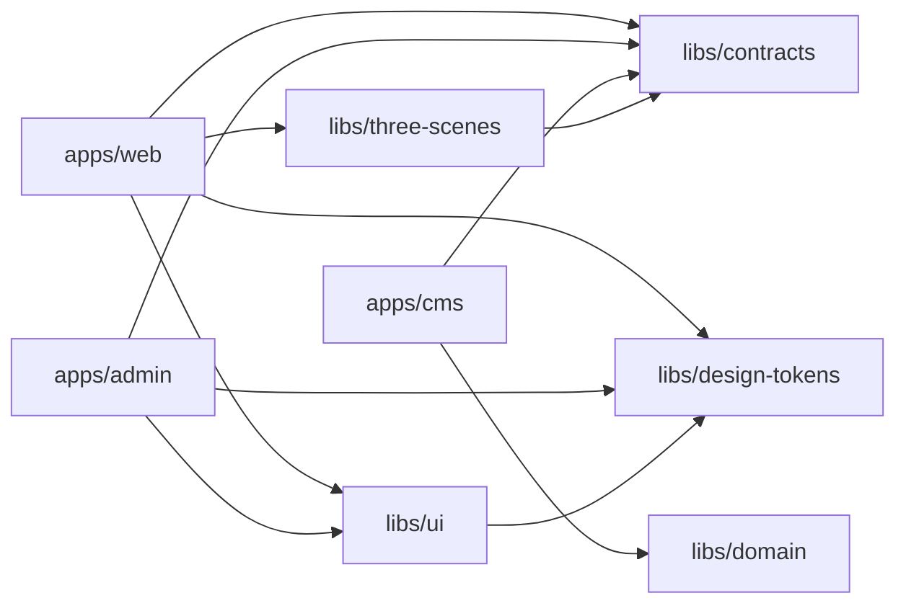
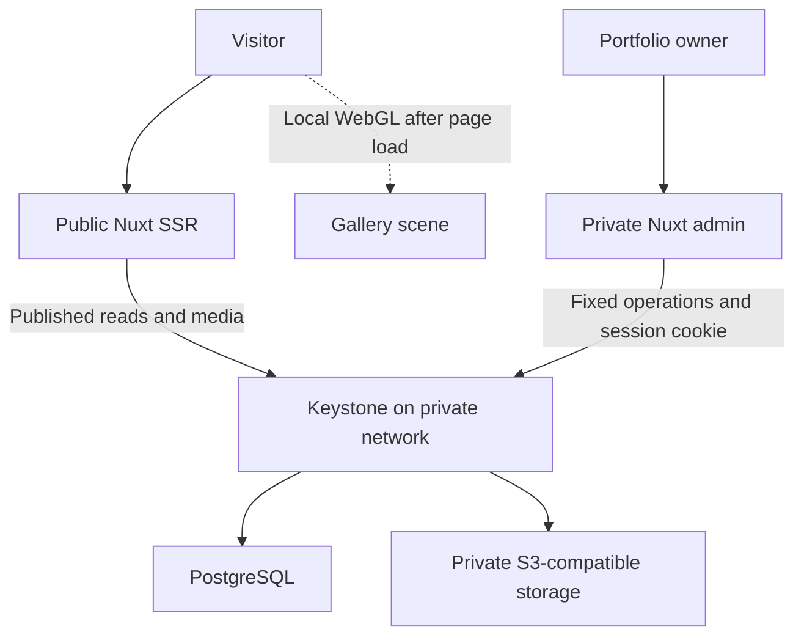

# Phase 1 architecture assessment

**Phase 3 implementation.** The content foundation uses the [current models and API boundaries](../phase-3-content-management.md). The design below records the earlier proposal for broader product scope.

**Review date** 24 November 2026  
**Status** Baseline reviewed in Phase 1.5. Owner approval is pending.

Keep Nx, the three application boundaries, Keystone as the authority for content and authentication, and PostgreSQL as the system of record. Make the public portfolio usable through server-rendered pages and use the gallery to enhance the homepage. Prove one station on a real mobile device before committing to the production treatment of five stations.

The greatest engineering cost is publishing, previewing, and revising related content and media safely. Build that workflow for one project before expanding the admin dashboard. The greatest delivery uncertainty is the set of approved case studies and assets. The reference cannot supply that evidence.

## Workspace inventory

| Checked | Observed |
| --- | --- |
| Root | `AGENTS.md` is present. `MASTER_PROMPT.md`, `skills-lock.json`, local agent skills, and one design image were present at intake. The skill lock describes agent tooling. |
| Git | `git rev-parse --show-toplevel` reports no Git repository at this path. Git history and a clean-worktree baseline are unavailable. |
| Application and Nx | No `apps/`, `libs/`, runtime manifest, dependency lockfile, Nx config, test config, or generated schema at intake. The graph below is a proposal. Graphify is unavailable here and there are no source dependencies to extract. |
| Tooling | Linux x86_64, Node `24.13.1`, npm `11.8.0`, Corepack `0.34.6`. pnpm is absent. The `yarn` command reports `0.32+git`, which does not establish a modern Yarn toolchain. |
| Infrastructure | Local Docker client and responding daemon both report `29.7.2`, with Compose `5.5.0`. The default `psql` reports `18.2` and `pg_dump` reports `15.16`. No PostgreSQL server or VPS capacity was verified. |
| Verification scope | File inventory, visual reference, registry engine and peer ranges, Keystone package source, and local Docker availability were checked. Integrated install, build, browser, and deploy evidence awaits an approved scaffold. |

## Version compatibility

Phase 1.5 rechecked the exact package candidates against upstream manifests. Phase 2 pins the Node/npm toolchain and records the resolved dependency graph after a clean install and representative builds.

| Area | Candidate and compatibility evidence |
| --- | --- |
| Node and package manager | Node `24.22.3` LTS with bundled npm `11.19.1` and npm workspaces. Nuxt `4.7.0` requires `^22.22.3 || ^24.15.0 || >=26.0.0`. The installed Node `24.13.1` misses the Node 24 floor. Align development, CI, and container builds. [Node releases](https://nodejs.org/en/about/previous-releases) · [Node release metadata](https://nodejs.org/dist/index.json) · [Nuxt manifest](https://registry.npmjs.org/nuxt/4.7.0) |
| Nx | `nx` and used `@nx/*` packages at `24.0.6`. The matching Nuxt plugin accepts Nuxt 4. Its Cypress and Playwright Nx peers are optional. Use Playwright from the approved stack and start with Nuxt task inference plus explicit CMS scripts. [Nx release policy](https://nx.dev/docs/reference/releases) · [Nx Nuxt integration](https://nx.dev/docs/technologies/vue/nuxt/introduction) · [Plugin manifest](https://registry.npmjs.org/@nx%2fnuxt/24.0.6) |
| Vue and compiler | Nuxt `4.7.0` resolves Vue `^3.5.46` and its Vite builder expects Vite `^8.3.8`. Use TypeScript `5.9.3` as the first candidate for Nuxt, Vue language tooling, Nx and Prisma. Let Nuxt own its builder version. [Nuxt manifest](https://registry.npmjs.org/nuxt/4.7.0) · [Nuxt builder](https://registry.npmjs.org/@nuxt%2fvite-builder/4.7.0) · [Nx TypeScript support](https://nx.dev/docs/technologies/typescript/introduction) |
| CMS and DB | Keystone `@keystone-6/core@8.3.0` with `@keystone-6/auth@10.0.6`. Core declares Prisma and client `^7.9.0`. Start with matched Prisma CLI, client and PostgreSQL adapter `7.10.1`, `pg` 8, and a supported PostgreSQL 18 patch. Prisma v7 lists PostgreSQL 18 as supported. Install declared React and Next peers where required by Keystone, and verify the server build with native UI disabled. Pin the runtime image and test generated schema, adapter and migrations together. [Core manifest](https://registry.npmjs.org/@keystone-6%2fcore/8.3.0) · [Auth manifest](https://registry.npmjs.org/@keystone-6%2fauth/10.0.6) · [Keystone database config](https://keystonejs.com/docs/config/config/) · [Prisma system requirements](https://www.prisma.io/docs/orm/v7/reference/system-requirements) · [Prisma v7 database matrix](https://www.prisma.io/docs/orm/v7/reference/supported-databases) |
| 3D | Evaluate TresJS core `5.12.0`, Three.js and matching typings `0.187.0`, and GSAP `3.15.1` during the scene prototype. Core declares Vue `>=3.4` and Three.js `>=0.133`. Prefer explicit scene integration. Add the Tres Nuxt module only if it solves a verified compiler or integration need. [TresJS install options](https://docs.tresjs.org/getting-started/installation/) · [TresJS manifest](https://registry.npmjs.org/@tresjs%2fcore/5.12.0) · [ScrollTrigger](https://gsap.com/docs/v3/Plugins/ScrollTrigger/) |
| Validation and tests | Zod 4 for boundary payloads. Vitest `5.1.1` accepts Node 24 and Vite 8. Playwright `1.65.1` declares Node `>=20`. Pin Playwright browser installation with the package. Prove Nuxt typecheck, lint plugins, and test transforms as part of Phase 2. [Vitest manifest](https://registry.npmjs.org/vitest/5.1.1) · [Playwright manifest](https://registry.npmjs.org/@playwright%2ftest/1.65.1) |

A peer range establishes eligibility only. Specifically test Vite 8 rendering and hydration, Keystone's no-UI packaging and database adapter in Linux, and TresJS on desktop and mobile WebGL. A successful local install alone says little about the Docker runtime.

## Proposed Nx project graph

Arrows show allowed source imports, including imports introduced in later phases. HTTP connections appear in the runtime diagram below.

| Project | Proposed first use | Responsibility |
| --- | --- | --- |
| `apps/web` | Phase 2 | Public Nuxt SSR, routes, content adapter, page composition, and SEO |
| `apps/admin` | Phase 2 | Nuxt admin and same-origin API facade forwarding Keystone sessions |
| `apps/cms` | Phase 2 project boundary and isolated build smoke, Phase 3 application runtime | Keystone lists, access rules, publication commands, GraphQL, migrations, and storage integration |
| `libs/design-tokens` | Phase 2 | CSS variables for color, type, space, and focus. Each app owns its theme. |
| `libs/contracts` | Phase 3 | Public DTO schemas and intentionally shared admin inputs and errors. Types are inferred from runtime schemas where practical. |
| `libs/domain` | Phase 3 | Framework-independent dates and publication rules with actual tests |
| `libs/ui` | Phase 4 or 5, on demonstrated reuse | Shared accessible primitives. Keep forms and editorial components local to their respective apps. |
| `libs/three-scenes` | Phase 6 | Client scene, assets, station geometry, camera and GPU lifecycle |
| `libs/shared-utils`, `libs/test-utils` | When sustained reuse appears | Reserved paths for repeated cross-project utilities or test fixtures. Skip empty projects. |

Use tags `scope:web`, `scope:admin`, `scope:cms`, `scope:shared` and type tags such as `type:app`, `type:contract`, `type:domain`, `type:ui`, `type:tokens`, and `type:scene`. Enforce the permitted edges with Nx ESLint boundary rules. Phase 2 must verify that the rules see Vue SFC imports and block an app-to-app import. Cover any demonstrated parser gap with a targeted ESLint import restriction. Export each library through a public entry point. Keep route adapters in the owning app and server-only modules out of browser imports. Test workspace resolution under Nuxt and Keystone's respective loaders. CMS schema changes require cross-app contract checks through CI because HTTP coupling is absent from the source graph. [Nx module boundaries](https://nx.dev/docs/features/enforce-module-boundaries)

## Application architecture

**Public.** Home `/` includes the introduction, gallery, selected projects, skills, experience, and contact action. `/projects` offers SSR filtering using validated query parameters, while `/projects/[slug]` renders a case study with canonical metadata and a true 404 for unpublished slugs. `/skills`, `/experience`, `/about`, and `/contact` read from the CMS. The Lab link can initially target a homepage section. Use Nuxt server-side data functions and narrow public GraphQL reads to avoid duplicate hydration fetches and SSR waterfalls. Generate sitemap and metadata from live revisions. Keep interface labels translation-ready, use CSS logical properties, and test direction changes before promising Persian content localization.

**Admin.** Build a focused dark application for authenticated editors. Group overview, projects, skills and categories, experience, media, profile, scene configuration, SEO and site settings, and revision history. Reuse local form patterns for status, dirty state, field errors, and loading. Follow one project through create, read, update, relation editing, private preview, publishing, archive and revision restore before scaling across modules. Profile and SEO can have distinct screens that edit fields of one site-settings aggregate. Keystone remains responsible for sessions and permissions. Start with route-local data state. Introduce Pinia only for a demonstrated cross-route requirement.

**CMS.** Use Keystone lists and read operations where they fit. Use narrow schema extensions where public projections, atomic editor saves, or publication require guarantees spanning multiple lists. Avoid a second service, arbitrary public GraphQL forwarding, and a generic admin CRUD engine. See the [database model](data-model.md) and [security design](security.md).

## Visual reference assessment

The supplied PNG is a 1448 × 1086 desktop composition. It places ivory serif hero copy at the left with an architectural corridor taking most of the width. Warm alcove spotlights and localized emerald signs control attention. A thin horizontal divider leads to an editorial projects rail with three large images, followed by skills and an experience timeline. The useful visual constraints are the architectural depth, warm material contrast, image framing, quiet dividers, and clear hierarchy.

| Adopt | Resolve before implementation |
| --- | --- |
| Editorial DOM text with a dark, stable reading surface over the hero | Determine mobile composition with a dedicated crop and stacked sections. Validate contrast over the lightest scene frame, text zoom, and keyboard focus. |
| Five recognizably different stations and a restrained accent color | Use consistent IDs and numbering from the brief. The image appears to label both Frontend and Backend as 02. |
| Case-study imagery and compact project cards | Obtain owner-approved assets and text. The reference's product imagery, descriptions, job responsibilities, and “Present” dates do not establish content facts. |
| Calm skills and experience sections | Treat the reference's `Admin` link and `View Reel` CTA as design options. Proposed first release uses the private admin URL and omits the reel CTA until approved footage exists. |

[Source design image](../design/AI-Native%20Engineer%20Portfolio%20Gallery.png) · [3D rendering architecture](3d-rendering.md)

## Risks and unresolved decisions

The Node patch is the immediate environment correction. Package installation, graph enforcement and the isolated Keystone/PostgreSQL runtime are Foundation exit gates. Publication, access control, browser fallback and recovery risks have separate gates and acceptance evidence. [Classified Phase 1.5 findings](phase-1.5-validation.md#findings-by-severity) · [Foundation acceptance](../development-roadmap.md#foundation-acceptance-criteria)
