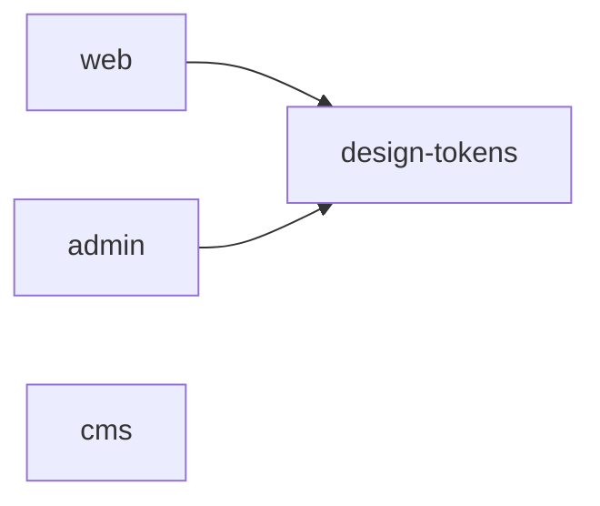

# Phase 2 — Foundation implementation report

**Scope** Approved Foundation, 24 November 2026

## Implemented architecture

`apps/web` and `apps/admin` build separate Nuxt 4 SSR applications that consume the CSS-only `@a/design-tokens` workspace package. Each shell contains a small browser interaction to verify hydration. `apps/cms` builds and starts Keystone with the native Admin UI disabled. Its only list is a temporary `FoundationProbe` fixture with generated GraphQL operations denied. The browser shells have no product CMS integration yet.

Nx inferred the Nuxt build targets and runs the explicit CMS and workspace targets. The boundary rules apply to TypeScript and Vue SFCs. The Vitest boundary checks generate an Nx graph through the prepare tasks before invoking ESLint, then exercise the real Vue parser and Nx rule.

The graph has four internal projects and two internal edges. The CMS connection to PostgreSQL is a runtime dependency.

## Files and configuration

| Area | Files |
| --- | --- |
| Workspace and tools | `.nvmrc`, `.npmrc`, `package.json`, `package-lock.json`, `nx.json`, `tsconfig.base.json`, `.editorconfig`, `.gitignore`, `.env.example`, `eslint.config.mjs`, `.prettierrc.json`, `.prettierignore` |
| Public and admin | App shells, workspace manifests, Nx targets, Nuxt configs and TypeScript references under `apps/web` and `apps/admin` |
| Shared CSS | Workspace manifest, Nx tags and token stylesheet under `libs/design-tokens` |
| CMS | `apps/cms/keystone.ts`, `prisma.config.ts`, workspace/target/TypeScript configuration, generated `schema.graphql` and `schema.prisma`, and one fixture migration under `apps/cms/tests/fixture-migrations` |
| Tests | `vitest.config.ts`, `playwright.config.ts`, SSR and boundary tests under `tests`, CMS HTTP and data checks under `apps/cms/tests`, and `scripts/smoke-cms.sh` |
| Documentation | Foundation setup in `README.md`, Phase 2 status in `docs/development-roadmap.md` and this report |

The local Git branch is `foundation`. Original files were inventoried by checksum. Install output, Nx and Nuxt caches, Keystone's generated client and internal build output, test output and local environment files are ignored.

## Versions

| Layer | Verified selection |
| --- | --- |
| Toolchain | Node.js 24.22.3, npm 11.19.1 |
| Workspace | Nx, Nuxt Nx plugin and boundary plugin 24.0.6 |
| SSR | Nuxt 4.7.0, Vue 3.5.46, Vite 8.3.8 |
| Checks | TypeScript 5.9.3, ESLint 10.15.0, Prettier 3.10.1, Vitest 5.1.1, Playwright 1.65.1 with Chromium |
| CMS | Keystone core 8.3.0, Prisma CLI/client/PG adapter 7.10.1, pg 8.23.1 |
| Integration | PostgreSQL server, pg_dump and pg_restore 18.7 with Node 24.22.3 and npm 11.19.1 inside Linux containers |

The isolated test uses the exact Node and PostgreSQL image digests in the smoke script. It supplies a private database URL to both Prisma Migrate and Keystone's PostgreSQL adapter.

## Database recovery procedure

Prisma Migrate applies forward migrations. An application transaction rollback and recovery from a committed migration or write are separate procedures. A reviewed corrective migration is the first option when the data can be repaired in place without discarding later writes. Verify the real schema and migration history, test the correction on an isolated copy, and apply the forward migration only after review. `prisma migrate resolve` records migration history when appropriate. It does not reverse SQL.

For a loss that requires a restore, use the matching PostgreSQL major-version tools and a verified backup. Restore into a new isolated database and verify data, constraints and migration status before changing any service connection. Preserve the original database for reconciliation. Compare the backup timestamp with the later writes that would be lost. Production recovery also requires the matching media backup and the launch approval process. [Keystone migrations](https://keystonejs.com/docs/guides/database-migration/) · [PostgreSQL 18 pg_restore](https://www.postgresql.org/docs/18/app-pgrestore.html)

The local drill in `npm run test:cms` runs only against the containers it creates.

1. Install the lockfile in a fresh Linux container, check the frozen schemas, apply the fixture migration, and write and read the baseline record. Force an error inside a Keystone transaction and assert the temporary record rolls back.
2. Start Keystone with its UI disabled. Verify the HTTP endpoint responds, the UI route returns 404, and unauthenticated fixture reads and writes do not expose data.
3. Capture a custom-format `pg_dump`. Simulate a bad release by changing the baseline row and adding a new one.
4. Restore the dump with `pg_restore --exit-on-error` into a second database. Assert the original record and its value are present, the later row is absent, and `prisma migrate status` reports that the restored schema is up to date.

## Commands and results

| Command | Observed result |
| --- | --- |
| `nvm install 24.22.3`, `node --version`, `npm --version` | NVM verified the distribution checksum. Reported versions were `v24.22.3` and `11.19.1`. |
| `npm ci --no-audit --no-fund --prefer-offline` | Fresh local installation from the lockfile succeeded. |
| `nx show projects`, `nx graph --file=/tmp/portfolio-phase2-nx-graph.json` | Export succeeded. A Node assertion verified the exact four nodes and two internal edges shown above. |
| `npm run lint -- --skip-nx-cache --output-style=static` | Three app targets passed. |
| `npm run typecheck -- --skip-nx-cache --parallel=2 --output-style=static` | Three app typechecks and their CMS generation prerequisite passed. |
| `npm run build -- --skip-nx-cache --parallel=2 --output-style=static` | Web, Admin and CMS builds passed. |
| `npm test` | Five Vitest tests passed. Tests cover two SSR shells, an allowed token import, and rejected relative and package imports from a Vue SFC. |
| `npx --yes --package @playwright/test@1.65.1 playwright install chromium`, `npm run test:e2e` | Two Chromium checks passed against the built Nuxt servers. Each checked served HTML, computed token styling, client interaction and browser errors. |
| `npm run format:check`, `npm run check:schema -w @a/cms` | Formatting passed. The frozen build confirmed both schemas and generated the Prisma client. |
| `npm run test:cms` | Fresh Linux `npm ci` passed. PostgreSQL 18.7 applied one fixture migration. The client wrote and read the baseline and rolled back the deliberately failed transaction. Keystone started, returned 404 on the UI route, returned an empty anonymous list and rejected anonymous writes with `KS_ACCESS_DENIED`. Backup recovery into `foundation_restored` preserved the baseline, excluded later writes and passed `prisma migrate status`. The disposable containers and network were removed. |

The Nx checks ran with the daemon disabled for repeatability. The original red tests identified the missing app shells and missing cached graph. The first Nx graph run exposed implicit Nuxt configuration imports, which now use explicit imports. Vitest uses the real Nuxt-generated TypeScript references from the prepare targets. The initial disposable test exposed a missing shared TypeScript config in the container copy. The smoke script now includes it. The fresh-context review prompted stricter checks for the anonymous GraphQL response and the exact denial code. CMS lint, typecheck and the complete container smoke passed again after that change.

## Remaining issues and deviations

All Foundation acceptance checks passed. The workspace matches the approved three-app architecture and includes only one shared library, the design tokens. ESLint 10 replaced the deprecated ESLint 9 candidate, and the CMS uses a fixture-only migration directory with a denied test list. Phase 3 owns the product CMS schema and migration history.

The install logs contain a transitive `whatwg-encoding` deprecation and npm lifecycle-script advisories. Nuxt 4.7 emits `NUXT_B2010` for its generated global-components plugin and falls back to runtime plugin metadata. Both built apps passed the SSR and browser checks. The PostgreSQL recovery evidence covers a disposable fixture. The production backup and media recovery rehearsal remains a Phase 7 gate.

Phase 3 awaits owner approval.
