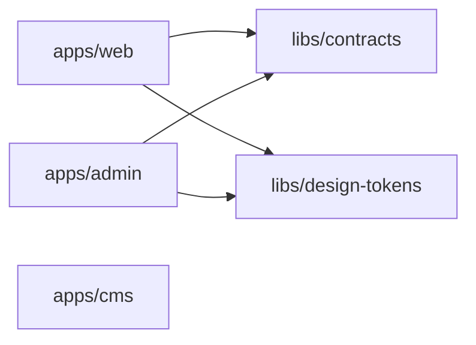

# Phase 3 — Portfolio Content Management Foundation

## Scope and delivery order

1. Add the Keystone schema, PostgreSQL migration, persistent owner session, and source seed.
2. Connect fixed Nuxt server routes to Keystone. Use shared DTOs via `libs/contracts` and keep HTTP connections outside the Nx import graph.
3. Deliver owner forms for technology stack, work experience, basic projects, and skill taxonomies. Render the same published catalogue on the public homepage.
4. Verify both facades against disposable PostgreSQL and exercise the editor and public page in the browser.

## Content model

| Content | Editable fields and relationships |
| --- | --- |
| Skill category and proficiency | Name, description, display order, draft/published, visibility |
| Skill | Name, description, optional logo, category and proficiency, many projects, display order, draft/published, visibility |
| Experience | Company, position, Persian start and optional end year/month, optional employment status, description, responsibilities, achievements, related skills, display order, draft/published, visibility |
| Project | Name, unique lowercase slug, optional short description and cover, related skills, display order, draft/published, visibility |

Experience status is independent of dates. The editor supports unknown status as a blank value. The public page prints the source Persian month and year. Deleting a taxonomy clears affected optional references. Skills and projects can edit either side of their relationship. Experience edits its own related skills. Ordering uses ascending display order followed by a stable ID. The [publication decision](decisions/0007-portfolio-content-foundation.md) defines how saves, visibility and media delivery affect readers.

The seed inserts 40 skills across the four supplied proficiency levels, five editable categories, two work records and three project names. All are drafts. The five categories are an initial editorial grouping. No employment end dates, status, responsibilities or achievements were supplied, and the seed leaves them blank. It also leaves project technology links and descriptions blank. Rerunning the seed preserves existing rows. A missing seed row is inserted again, so run the seed during initial setup or when those rows are intentionally needed.

## API and authorization

| Application | Routes |
| --- | --- |
| Admin Nuxt | `GET/POST/DELETE /api/session`; `GET/POST /api/content`; `DELETE /api/content/:kind/:id` |
| Public Nuxt | `GET /api/portfolio`; `GET /api/images/:kind/:id` |
| Keystone | Private GraphQL with generated owner CRUD, Keystone auth, and projected `publicPortfolio` and `publicImage` queries |

Passwords use Keystone's password field. The owner account is created from the CLI with environment credentials. The host-only session cookie is HttpOnly, SameSite=Lax, Secure by default, and expires after eight hours. PostgreSQL stores hashed session keys and expiry. Signing out deletes the stored session. The admin route checks the configured origin on sign-in, sign-out and writes. CMS network isolation, the HTTPS proxy, and production rate-limit configuration still require staging validation. The localhost HTTP switch is for development and the automated browser suite. Use distinct public and admin hostnames in production.

## Run locally

Use the [pinned Foundation toolchain](phase-2-foundation.md). Set `CMS_DATABASE_URL` to a development PostgreSQL 18 database and export the values in [.env.example](../.env.example) for the processes that need them. Generate a random `CMS_SESSION_SECRET` of at least 32 characters. Use a unique 16–128 character owner password and keep it out of source. For the local URLs below, set `CMS_INSECURE_DEV_COOKIE=1` for the CMS and `NUXT_ADMIN_ORIGIN=http://127.0.0.1:3001` for the admin. Start the apps with the following commands in separate terminals after setup.

```bash
npm ci
npm run build
npm run migrate:deploy -w @a/cms
npm run owner:create -w @a/cms
npm run seed:content -w @a/cms

npm run start -w @a/cms
PORT=3001 HOST=127.0.0.1 node apps/admin/.output/server/index.mjs
PORT=3000 HOST=127.0.0.1 node apps/web/.output/server/index.mjs
```

Open the admin on port 3001, publish the intended records and any related records that should be visible, and reload the public page on port 3000. Published edits apply on the next public request. For migration recovery, use a reviewed corrective migration or restore into a separate database as described in the [Foundation recovery procedure](phase-2-foundation.md).

## Verified Nx graph



The graph contains three apps and two shared libraries. ESLint applies Nx boundary rules to TypeScript and Vue SFC code. Keystone and PostgreSQL are runtime services, reached from the Nuxt servers through fixed HTTP operations.

## Verification

| Check | Result |
| --- | --- |
| Node 24.22.3, npm 11.19.1, `npm ci` | Lockfile install passed |
| `npm run lint`, `npm run typecheck`, `npm run build`, `npm run format:check` | Passed on the current workspace |
| `npm test` | 5 Vitest tests passed, including Vue SFC import boundaries and Persian month formatting |
| `npm run check:schema -w @a/cms` | Frozen GraphQL and Prisma schemas matched and Prisma Client generated |
| `npm run test:e2e` | 4 Playwright tests passed against the built applications and a fresh PostgreSQL 18.7 database |
| `npm run test:cms` | Passed clean install in Linux, both migrations, Keystone startup, write/read, rollback, isolated backup restore and restored migration history |
| Nx graph | Exported and checked all five nodes and the four source import edges |

Playwright verified all 40 seed names and proficiency values against the brief, preserved unknown experience fields, and covered owner login and logout, rejected anonymous and sibling-origin operations, session replay rejection, CRUD across all five lists, relationship filtering, validation, ordering, media withdrawal, and published SSR. On a mobile viewport the browser signed in, reloaded the authenticated admin, published each of the three content types, and confirmed that the public page displayed the changes. A separate CMS check verified Secure cookie defaults, non-owner login rejection, and database-backed session expiry.

The isolated recovery test used matching PostgreSQL 18.7 dump and restore tools. The container used the workstation’s approved CA through `NODE_EXTRA_CA_CERTS` for its npm install.

The only new direct external dependencies are Keystone Auth 10.0.6 and Sharp 0.35.5. Sharp was already in the lockfile and is now a direct CMS dependency for image decoding and transcoding. The workspace retains Nuxt 4.7.0, Vue 3.5.46, Nx 24.0.6, Keystone Core 8.3.0, Prisma 7.10.1, and pg 8.23.1. Nuxt emitted its existing generated-plugin metadata warning. Prisma's nested relationship loader emitted a pg deprecation about concurrent driver calls. PostgreSQL reads passed and that warning should be tracked before adopting pg 9.

Phase 4 requires explicit approval.
